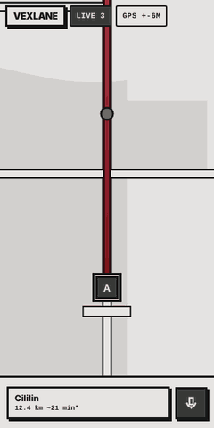
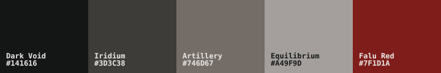

<h1 align="center">VEXLANE</h1>

<b>004 - EVTEAM</b>

VEXLANE is a web app for motorcycle touring groups. Everybody sees everybody on one map, the group shares one destination, and each rider gets a route from the place they are actually standing, not from where the leader started. It is made to live inside an Android WebView, to be hosted for free on GitHub Pages, and to need no server of ours.

It is easiest to understand by what it refuses to do.

**Three hard refusals**

1. **No toll roads. Ever.** The riders are on motorcycles. Every route request, every reroute, every answer is checked for toll (details below). A route that still touches one is faded out, its guidance is switched off, and the phone buzzes.
2. **No framework, no build step.** HTML, CSS and vanilla JavaScript modules. Open the folder in a static server and it runs. The only dependencies are Firebase's SDK, Leaflet and, if you tap 3D, MapLibre.
3. **No server.** Firebase Auth and Realtime Database carry the state, public map services carry the geography, WebRTC carries the voice between phones.

**Four quiet ones**

- Navigation never makes a sound. A popup and a vibration, that is all.
- Old coordinates never pose as current. A rider is shown as live, old fix, lost, offline or not sharing, and a stale dot is drawn faded.
- No history. The database holds where you are now, not where you have been.
- No paid service is used silently. Providers that need a key ship as placeholders that stay off until you fill them in.

## A ride in sixteen seconds

This clip is rendered headlessly from the app's own stylesheet with a scripted route. The map in it is drawn, not live tiles, and the numbers are made up. What it shows is real behavior:

1. A small popup says the next kabupaten is coming up, with its weather.
2. The turn card warns 300 m before the turn, then says "Sekarang" at the turn.
3. The rider takes a wrong turn. After two GPS fixes the app calls it: red card, vibration, and the old line fades instead of disappearing.
4. A new route is drawn from where the rider is now. If the wrong turn was the wrong road, nobody had to press anything.

## What is inside

**The convoy.** A room is made with a random ten-symbol invite code. The owner picks how many riders it holds, from 2 to 30 (default 6), and the database rules enforce that number, not just the screen. Riders join with the code, see a preview first, and can be removed or banned. Profile photos can be animated GIFs: they are shrunk to a small square in the browser (no library) and keep moving on the map and in lists. Positions move through Firebase every 1.5 s or 5 m while riding, 30 s while standing still, and a rider's phone says when it has gone quiet.

**The map.** Flat by default (Leaflet and OpenStreetMap). Tap 3D for a tilted MapLibre map with extruded buildings, house numbers and a camera that turns with your heading; hills show as a soft relief, and a NEON button switches a night-city map skin on and off, and a speaker button turns on spoken turn-by-turn directions with the phone's own text-to-speech (`docs/SPOKEN-NAV.md`). Your own dot is gently pulled onto your route line, and stays still when you stand still. The route is a muted red that fades to soft white toward the destination.

**Getting there.** Set the destination by searching a place, typing coordinates or tapping the map. Each rider's route comes from OSRM starting at that rider's own position. Leave the route and the reroute starts within about 3.5 seconds, retrying with a growing delay if the signal is bad. While you keep riding the wrong way (off the route, or away from the destination when there is no route to judge by) the red card stays up and the phone buzzes again every four seconds; stop riding and it goes quiet. Turn alerts (far, near, now) come as a popup plus a vibration.

**Region alerts.** Shortly before you cross into another kabupaten or kota, a small popup says so, with the weather there:

> **Sebentar lagi memasuki Kab. Bandung Barat, Cililin**
> Cerah · 30°C

It looks 0.8 to 1.5 km ahead along the route (or along your heading if there is no route), shows once per region, and stays on screen for about seven seconds. Switch it off in the Room menu.

**Talking.** Hold the mic and everyone online hears you: WebRTC straight between phones, mono Opus, microphone open only while the button is held, nothing recorded. Discord stays one tap away as the backup.

## The toll rule, in four layers

Motorcycles are not allowed on toll roads in Indonesia, so a wrong guess here is not a cosmetic bug. The app does not rely on any single check.

1. The server is asked for a route with `exclude=toll`.
2. If it still answers with toll or motorway, it is asked again with `exclude=motorway`, then without any exclusion.
3. Every answer is scanned for the `toll` and `motorway` road classes, and for roads literally named "Tol".
4. If every option touches one, the route is shown faded, turn guidance is turned off for it, a red warning appears and the phone gives a long vibration. A hiccup from the routing server cannot switch the toll filter off for the rest of the session either.

This depends on what the routing data knows. It is a strong guard, not a guarantee, and the warning exists for the day the data is wrong.

## The palette

Five colors, one light tint of Equilibrium for cards, defined once in `css/tokens.css`. Dark Void for text and borders, Iridium for anything filled or selected, Artillery for secondary fills, Equilibrium for the page and for warnings, Falu Red only for danger, errors, off-route, tolls and the cancel / back / close buttons. Neo-Brutalist rules apply: hard offset shadows, thick borders, no blur. Warnings differ by a dashed border, not by another color.

## Said out loud

- A route is an estimate. The public OSRM demo uses a car profile, no live traffic, no closures. Turn-by-turn is a helper, not a replacement for looking at the road.
- Region names and weather come from free public services (Nominatim, Open-Meteo). They are for light use, can be slow or wrong near borders, and the popup simply stays quiet when they fail.
- The free Firebase plan has hard limits (100 simultaneous connections, 1 GB stored, 10 GB per month of traffic). Every rider's position goes to every other rider, so the traffic grows roughly with the square of the room size: a room of 30 is far heavier than a room of 6.
- No push notifications and no background tracking in a browser or WebView.
- The database rules tests in `firebase/tests` need the Firebase emulator. `node tests/rules-eval-test.mjs` runs the same create and join scenarios against a small local evaluator of the rules file, which is a good smoke test but not Firebase itself; confirm in the Rules Playground. If you ever see "permission denied" when creating a room, the rules in the console are older than the app: publish `firebase/database.rules.json` again.
- Most of this was verified in simulation: a fake map library, scripted GPS rides, mocked networks. Real roads, real tiles and real signal are the final judge, so ride a short loop before a long trip.
